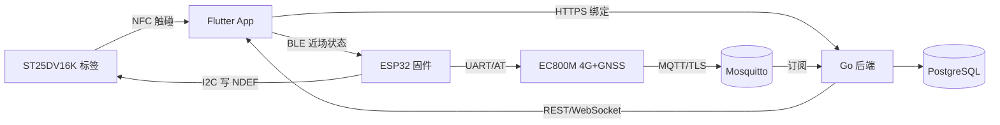

# 自行车定位与骑行记录

一套「硬件 + 手机端 + 云端」的自行车定位与骑行记录系统，面向车辆定位、骑行记录和防盗。

Android App 已能通过公开 HTTPS API 注册、登录、手动绑定、查看车辆列表和解绑。后端使用 JWT 鉴权与 Postgres 存储，账号与车辆流程已通过 Android 模拟器公网验收。入口、鉴权与验证方法见 [部署与联调环境](docs/deployment.md)。

地图支持显示当前车辆的最新位置与最近轨迹。真实车载定位上报、NFC/BLE 接入、Android 真机验收和 iOS 打包仍待完成。固件构建与提示音验证见 [固件 README](firmware/README.md)，其他验收项见 [路线图](docs/roadmap.md)。

## 组成

| 目录 | 角色 | 技术栈 | 说明 |
|---|---|---|---|
| `app/` | 手机端 | Flutter + Riverpod + go_router | 绑定、地图、骑行记录、车辆设置 |
| `firmware/` | 车载硬件固件 | ESP-IDF (C) + NimBLE | UART 驱动 EC800M 模组，采样并上报 |
| `backend/` | 云端服务 | Go + pgx + Postgres | 账号与车辆 HTTP API，支持 MQTT TLS 上报入库 |
| `docs/` | 设计与契约 | Markdown + Mermaid | **改协议先改这里** |

硬件由 ESP32-S3 + Quectel **EC800M**（Cat.1，GNSS 为选配版本）+ **ST25DV16K** NFC 标签组成，
详见 [docs/hardware.md](docs/hardware.md)。

## 目标数据通路



改动跨端接口前查阅对应契约。

- [docs/protocol.md](docs/protocol.md) —— 设备 ↔ 云（MQTT 主题与 JSON 信封）
- [docs/pairing.md](docs/pairing.md) —— App ↔ 设备（NFC 绑定流程与 BLE 近场）
- [docs/http-api.md](docs/http-api.md) —— App ↔ 后端（HTTP API、JWT 与错误码）
- [docs/data-model.md](docs/data-model.md) —— 云端持久化实体

## 快速开始

```bash
bash scripts/check-env.sh   # 先看缺哪些工具链

# 后端
cd backend && cp .env.example .env   # 填 CLAIM_PEPPER
go build ./... && go test ./...
docker compose up -d --build --wait  # nginx + backend
docker compose --profile deps up -d  # 可选；需先在 .env 填 POSTGRES_PASSWORD

# 手机端（需先安装 flutter）
cd app && flutter pub get && flutter analyze && flutter test

# 固件（需先安装 ESP-IDF v5.x 并 export.sh）
cd firmware && idf.py set-target esp32s3 && idf.py build
```

## 文档索引

| 文档 | 内容 |
|---|---|
| [docs/architecture.md](docs/architecture.md) | 分层、模块 seam、数据流、失败模式 |
| [docs/protocol.md](docs/protocol.md) | MQTT 主题、信封、幂等与离线缓存 |
| [docs/pairing.md](docs/pairing.md) | NFC 绑定状态机、BLE GATT 定义 |
| [docs/http-api.md](docs/http-api.md) | App↔后端 HTTP API、用户、JWT、错误码 |
| [docs/data-model.md](docs/data-model.md) | 表结构与索引 |
| [docs/hardware.md](docs/hardware.md) | BOM、引脚、电源预算、天线 |
| [docs/roadmap.md](docs/roadmap.md) | M0–M4 里程碑 |
| [docs/deployment.md](docs/deployment.md) | 联调服务器、访问入口与部署操作 |
| [docs/branch-protection.md](docs/branch-protection.md) | main 分支保护规则、必需检查与应急流程 |
| [docs/adr/](docs/adr/) | 架构决策记录 |
| [CONTRIBUTING.md](CONTRIBUTING.md) | 协作规范、提交与评审流程 |
| [AGENTS.md](AGENTS.md) | 给 AI/新成员的工作约束 |

## 许可

尚未确定（TBD）。
