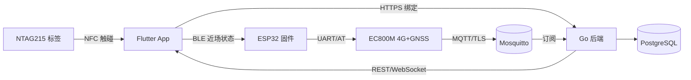

# 自行车定位与骑行记录

一套「硬件 + 手机端 + 云端」的自行车定位与骑行记录系统。装在车上的 ESP32 硬件通过 4G 上报 GPS 轨迹；
手机 App 用 NFC 触碰完成绑定、实时查看车辆位置与骑行记录；后端负责接收数据、存储轨迹并判定防盗告警。

> **当前状态：仓库骨架阶段（M0）。**
> 三个子项目只有接口与空实现，业务逻辑尚未编写。
> 已验证：`backend/`（build / vet / test / gofmt + 绑定接口冒烟）、`app/`（analyze / test / format）、
> `firmware/` 的纯 C 模块（gcc 编译 + 主机单测）。
> 尚未验证：`firmware/` 的 ESP-IDF 构建；`app/` 还缺 `android/`、`ios/` 平台目录（见 [app/README](app/README.md)）。
> 先跑 `scripts/check-env.sh` 确认工具链，再按下文命令构建。

## 组成

| 目录 | 角色 | 技术栈 | 说明 |
|---|---|---|---|
| `app/` | 手机端 | Flutter + Riverpod + go_router | 绑定、地图、骑行记录、车辆设置 |
| `firmware/` | 车载硬件固件 | ESP-IDF (C) + NimBLE | UART 驱动 EC800M 模组，采样并上报 |
| `backend/` | 云端服务 | Go（标准库起步） | MQTT 接入 + HTTP/WebSocket API |
| `docs/` | 设计与契约 | Markdown + Mermaid | **改协议先改这里** |

硬件由 ESP32 + Quectel **EC800M**（Cat.1，需 GNSS 选配版）+ NTAG215 NFC 标签组成，详见 [docs/hardware.md](docs/hardware.md)。

## 数据通路



三条跨端契约，改动前必读：

- [docs/protocol.md](docs/protocol.md) —— 设备 ↔ 云（MQTT 主题与 JSON 信封）
- [docs/pairing.md](docs/pairing.md) —— App ↔ 设备（NFC 绑定流程与 BLE 近场）
- [docs/data-model.md](docs/data-model.md) —— 云端持久化实体

## 快速开始

```bash
bash scripts/check-env.sh   # 先看缺哪些工具链

# 后端
cd backend && cp .env.example .env && go build ./... && go test ./...
docker compose up -d       # 本地 broker + postgres

# 手机端（需先安装 flutter）
cd app && flutter pub get && flutter analyze && flutter test

# 固件（需先安装 ESP-IDF v5.x 并 export.sh）
cd firmware && idf.py set-target esp32s3 && idf.py build
```

## 文档索引

| 文档 | 内容 |
|---|---|
| [docs/architecture.md](docs/architecture.md) | 分层、模块 seam、数据流、失败模式 |
| [docs/protocol.md](docs/protocol.md) | MQTT 主题、信封、幂等与离线缓存 |
| [docs/pairing.md](docs/pairing.md) | NFC 绑定状态机、BLE GATT 定义 |
| [docs/data-model.md](docs/data-model.md) | 表结构与索引 |
| [docs/hardware.md](docs/hardware.md) | BOM、引脚、电源预算、天线 |
| [docs/roadmap.md](docs/roadmap.md) | M0–M4 里程碑 |
| [docs/branch-protection.md](docs/branch-protection.md) | main 分支保护规则、必需检查与应急流程 |
| [docs/adr/](docs/adr/) | 架构决策记录 |
| [CONTRIBUTING.md](CONTRIBUTING.md) | 协作规范、提交与评审流程 |
| [AGENTS.md](AGENTS.md) | 给 AI/新成员的工作约束 |

## 许可

尚未确定（TBD）。
