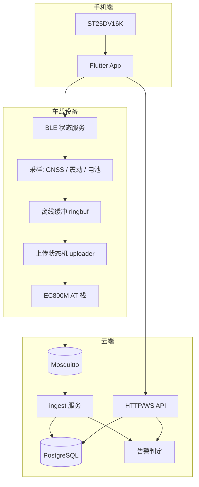

# 系统架构

## 1. 目标与约束

**目标**：低功耗自行车定位与骑行记录。核心价值是「车丢了能找回」和「骑完能看到数据」。

**硬约束**（决定了很多设计）：

| 约束 | 后果 |
|---|---|
| 车载设备靠电池，且长期停放 | 必须有深度睡眠；静止时降频定位；BLE 只在需要时开广播 |
| 山区/地下车库无信号 | 必须离线缓存至少 72 小时，联网后补传 |
| Cat.1 上行仅约 5 Mbps、按流量计费 | 不做实时音频/图片；轨迹点压缩后批量上报 |
| 设备无法经常 OTA | **一切可变的业务逻辑放后端**，固件只做采样与传输 |
| 设备时钟在无 GNSS 时不可靠 | 排序只信 `seq`；时间用 GNSS UTC，缺失时标记 |
| 设备装在露天，物理可及 | 绑定靠声明码（在设备已绑定期间失效）；解绑只能服务端发起 |
| **设备在运营商 CGNAT 之后**（实测私网 IP `10.43.x.x`） | 后端**无法主动连接设备**：broker 必须公网可达，下行指令只能靠设备订阅后经 broker 中转 |

## 2. 分层

设备这一侧还有一条链路：**固件经 I²C 改写 NFC 标签里的绑定 URI**，所以声明码可以轮换
（[ADR-0004](adr/0004-st25dv16k-tag.md)）。它不在上面这张数据流图里，因为不参与数据上报。

三条链路彼此不共享代码，只共享**文档化契约**：

| 契约 | 文档 | 两侧实现 |
|---|---|---|
| 设备↔云 | [protocol.md](protocol.md) | 固件 `main/proto` ↔ 后端 `internal/protocol` |
| App↔设备 | [pairing.md](pairing.md) | 固件 `main/ble`、`main/nfc` ↔ App `core/ble`、`core/nfc` |
| App↔云 | OpenAPI（后端生成） | 后端 `internal/api` ↔ App `core/api` |

## 3. 深模块与 seam

原则：**接口小、实现深**；能变的东西放在 seam 后面，改它不必改调用方。

### 固件

| 模块 | 接口（小） | 藏在里面的东西（深） |
|---|---|---|
| `modem/modem_at` | `modem_at_cmd(cmd, expect, buf, timeout)` | UART 收发、URC 穿插、重试、超时、行缓冲 |
| `modem/modem_mqtt` | `mqtt_publish(topic, payload, len, qos, retain)` | QMTOPEN/CONN/PUBEX 序列、断线重连、TLS 配置 |
| `modem/modem_gnss` | `gnss_read_fix(&fix)` | QGPS 开关、NMEA/QGPSLOC 解析、首次定位等待 |
| `track/ringbuf` | `rb_push(rec)` / `rb_peek_batch()` / `rb_ack(n)` | flash 分页、掉电一致性、容量回收、丢弃计数 |
| `track/uploader` | `uploader_run()` | 批量打包、退避重试、离线状态发布、睡眠前收尾 |
| `ble/ble_status` | `ble_publish_status()` / `ble_set_enabled(bool)` | GATT 表、分片重组、广播开关 |

**只在 `modem/` 内出现 AT 指令字符串**。其他模块调接口，不拼 AT。

### 后端

| 模块 | 接口 | 实现深度 |
|---|---|---|
| `internal/ingest` | `Handle(ctx, env) error` | 校验、幂等去重、批量落库、触发骑行重组与告警 |
| `internal/store` | `Store` 接口（按领域方法，不暴露 SQL 类型） | 事务边界、索引选择、分页 |
| `internal/device` | `Bind(ctx, deviceID, claimCode) error` / `Unbind(...)` | 声明码哈希校验、占用判定、限流、指令下发 |
| `internal/api` | HTTP handler（薄） | 只是解码→调服务→编码 |

`ingest.Handle` 是纯逻辑：入参是已解出的信封，依赖注入 `Store` 与 `Clock`，**不碰网络**，因此可单测。

### 手机端

| 模块 | 接口 | 实现深度 |
|---|---|---|
| `core/api` | `ApiClient`（`bindDevice`、`listRides`、`watchPosition`…） | 重试、鉴权刷新、错误归一化 |
| `core/ble` | `BleClient.watchStatus(deviceId)` | 扫描、MTU 协商、分片、重连 |
| `core/nfc` | `NfcReader.readBindTag()` → `BindTag?` | 两平台差异、NDEF 解析、URL 校验 |
| `features/*/data` | Repository | 缓存、分页、DTO→领域模型、单位换算 |

Widget 只见 Provider 与领域模型，不见 DTO、不见 HTTP。

## 4. 关键流程

### 4.1 一次轨迹上报

1. 设备每 `sample_interval_s` 读一次 GNSS，写入 `ringbuf`（带 `seq`，`seq` 先持久化再使用）。
2. `uploader` 每 `upload_interval_s` 或联网恢复时取一批点打包成 `telemetry`，经 MQTT 发布。
3. 后端 `ingest` 校验信封 → 按 `(id, seq)` 去重 → 批量插入 → 更新 `devices.last_seen_at`。
4. 同一条轨迹点按时间窗归入 `ride`（见 [data-model.md](data-model.md) §3）。
5. 若触发围栏或震动规则，写 `alerts` 并通过 WebSocket 推给在线 App。

### 4.2 防盗告警

震动事件由设备判定最基础的一级（低成本、能立刻触发），**升级与确认在后端**：

- 设备：震动超过阈值 → 发 `event{motion}`，同时提高采样率 5 分钟。
- 后端：判断设备是否在围栏内、车主是否"在车旁"（App 最近一次 BLE 近场提示，**仅作参考不作判据**）、
  历史上同一时段是否频繁误报 → 决定是否推 `critical` 告警。
- 这样调整灵敏度只改后端规则，不必 OTA。

## 5. 失败模式与降级

| 故障 | 行为 |
|---|---|
| 无蜂窝信号 | 数据入 FIFO，`dropped` 累计；恢复后按序补传 |
| GNSS 无定位 | 不上报伪造坐标；`fix=0` 的状态点可选上报用于判活 |
| Broker 不可达 | 指数退避重连（1s→2s→4s…上限 5 min），期间只缓存 |
| 深度睡眠前 | 主动发布 `status{online:false}` 再断开（LWT 不会触发，见 protocol.md §2.2） |
| 掉电时正在写 flash | `ringbuf` 用「写记录+最后写头指针」保证只丢最后一条 |
| 重复投递 | 幂等键 `(id,seq)`，重复视为成功 |
| 设备时钟跳变 | 排序以 `seq` 为准；`ts` 仅用于展示与骑行切分，异常时后端用接收时间兜底 |
| 声明码泄露 | 设备已绑定期间该码无效；解绑后原码恢复可用，此时风险由"解绑只能车主发起"限制 |
| 后端宕机 | 设备继续缓存；MQTT 保留消息让 App 看到离线状态 |

## 6. 明确不做的事

- 不在设备端做轨迹压缩、里程计算、围栏判定（改不动，全放后端）。
- 不用 BLE 传轨迹数据（带宽与距离都不现实）。
- 不做设备直连手机热点上传（车主不在就无法上报，与防盗目标冲突）。
- 不做设备间组网。

## 7. 目录 ↔ 模块映射

| 概念 | 固件 | 后端 | App |
|---|---|---|---|
| 协议编解码 | `main/proto` | `internal/protocol` | `core/models` |
| 存储 | `main/track/ringbuf.c` | `internal/store` | 本地缓存（后续） |
| 传输 | `main/modem`, `main/track/uploader.c` | `internal/mqtt` | `core/api` |
| 绑定 | `main/ble`, NVS | `internal/device` | `features/device/pairing` |
| 业务 | —（有意为空） | `internal/ingest`, `internal/ride` | `features/*` |
