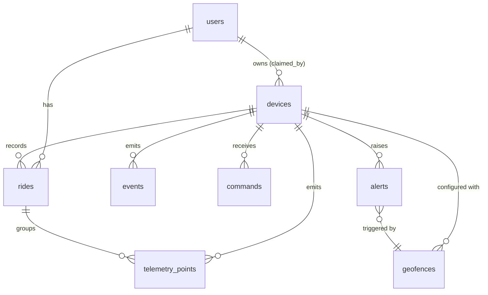

# 数据模型

PostgreSQL 15+。时间统一 `timestamptz`，坐标统一 WGS-84，单位见 [protocol.md §4](protocol.md)。

## 1. 实体关系

## 2. 表结构

### users

| 列 | 类型 | 说明 |
|---|---|---|
| `id` | `uuid` PK | |
| `email` | `citext` UNIQUE NOT NULL | 登录名 |
| `password_hash` | `text` NOT NULL | argon2id |
| `display_name` | `text` | |
| `created_at` | `timestamptz` NOT NULL DEFAULT now() | |

### devices

| 列 | 类型 | 说明 |
|---|---|---|
| `id` | `text` PK | `deviceId`，如 `BKL-2026-000123`，**不用自增** |
| `model` | `text` NOT NULL | 硬件型号 |
| `claim_code_hash` | `text` | 带服务端 pepper 的 HMAC-SHA256；**绑定后保留不删**，用于区分"码错"与"已绑定" |
| `claim_code_prev_hash` | `text` NULL | 轮换宽限期内的旧码哈希（M3）；NULL 表示没有待退场的旧码 |
| `claim_code_prev_expires_at` | `timestamptz` NULL | 旧码失效时刻；到期后由后台任务把上面两列置 NULL |
| `device_secret_hash` | `text` | MQTT 密码哈希 |
| `claimed_by` | `uuid` NULL REFERENCES users | 当前车主；NULL = 可绑定 |
| `claimed_at` | `timestamptz` NULL | 绑定时写入，**不可回滚为 NULL**（解绑写 `unbound_at`） |
| `state` | `text` NOT NULL | `FACTORY` / `CLAIMABLE` / `CLAIMED` |
| `fw_version` | `text` | 最近上报的固件版本 |
| `last_seen_at` | `timestamptz` | 由 `status` 更新 |
| `last_fix_at` | `timestamptz` | 最近一次有效定位 |
| `label` | `text` | 用户备注，如「通勤车」 |
| `config` | `jsonb` NOT NULL DEFAULT '{}' | 见 protocol.md §7.1 |

约束：`CHECK (state IN ('FACTORY','CLAIMABLE','CLAIMED'))`。
索​​引：`(claimed_by) WHERE claimed_by IS NOT NULL`（查我的车）。

### device_bindings（历史，审计用）

| 列 | 类型 | 说明 |
|---|---|---|
| `id` | `bigserial` PK | |
| `device_id` | `text` REFERENCES devices | |
| `user_id` | `uuid` REFERENCES users | |
| `bound_at` / `unbound_at` | `timestamptz` | 解绑只写 `unbound_at` |
| `reason` | `text` | `user_table` / `support` / `factory_reset` |

现有绑定以 `devices.claimed_by` 为准，本表只做追溯。

### telemetry_points

主表，量级最大（每车每天约 8k 点 @10 s）。

| 列 | 类型 | 说明 |
|---|---|---|
| `device_id` | `text` NOT NULL | |
| `seq` | `bigint` NOT NULL | 设备序号 |
| `ts` | `timestamptz` NOT NULL | 设备时间 |
| `received_at` | `timestamptz` NOT NULL DEFAULT now() | 服务端收到时间 |
| `geom` | `geography(Point,4326)` | PostGIS；先用 `lat`/`lon` 也可 |
| `lat` / `lon` | `double precision` | 冗余存储便于无扩展部署 |
| `speed_mps` | `real` | |
| `course_deg` | `real` | |
| `alt_m` | `real` | |
| `hdop` | `real` | |
| `fix` | `smallint` | 0/2/3 |
| `quality` | `smallint` DEFAULT 0 | 0 正常 / 1 低质量（hdop>3） |
| `ride_id` | `uuid` NULL REFERENCES rides | 后台重组时回填 |

- PK：`(device_id, seq)` —— **幂等的物理保证**，`ON CONFLICT DO NOTHING`。
- 索引：`(device_id, ts DESC)`；`(ride_id)` 部分索引。
- 分区：按 `ts` 月度 `PARTITION BY RANGE`（M2 再做，先单表）。

### rides

| 列 | 类型 | 说明 |
|---|---|---|
| `id` | `uuid` PK | |
| `device_id` | `text` NOT NULL | |
| `user_id` | `uuid` NOT NULL | 记录产生时的车主 |
| `started_at` / `ended_at` | `timestamptz` | |
| `distance_m` | `integer` | 后端按点累加（剔除跳变） |
| `duration_s` | `integer` | 移动时长，不含静止 |
| `avg_speed_mps` / `max_speed_mps` | `real` | |
| `point_count` | `integer` | |
| `status` | `text` | `open` / `closed` |

索引：`(user_id, started_at DESC)`。

**骑行切分规则**（后端，M2）：相邻点间隔 > 10 min 视为新骑行；速度连续 5 min 低于 1 km/h 则结束并结算。
规则可调，改这里不影响固件。

### events

| 列 | 类型 | 说明 |
|---|---|---|
| `id` | `bigserial` PK | |
| `device_id` | `text` NOT NULL | |
| `ts` | `timestamptz` NOT NULL | |
| `type` | `text` NOT NULL | protocol.md §5 的枚举 |
| `level` | `text` NOT NULL | info/warn/critical |
| `geom` / `lat` / `lon` | 同上 | 可空 |
| `data` | `jsonb` | 原始附加信息 |

索引：`(device_id, ts DESC)`；`(type, ts DESC)`。

### geofences

| 列 | 类型 | 说明 |
|---|---|---|
| `id` | `uuid` PK | |
| `device_id` | `text` NOT NULL | |
| `user_id` | `uuid` NOT NULL | |
| `name` | `text` | 如「家」「公司」 |
| `center` / `lat` / `lon` | 同上 | |
| `radius_m` | `integer` NOT NULL CHECK (>0) | |
| `enabled` | `boolean` DEFAULT true | |
| `notify_on` | `text` | `exit` / `enter` / `both` |

### alerts

| 列 | 类型 | 说明 |
|---|---|---|
| `id` | `uuid` PK | |
| `device_id` / `user_id` | | |
| `kind` | `text` | `motion` / `geofence` / `low_battery` / `tamper` |
| `level` | `text` | |
| `created_at` | `timestamptz` | |
| `acked_at` | `timestamptz` NULL | 用户已读 |
| `context` | `jsonb` | 触发时的判据快照，便于复盘误报 |

索引：`(user_id, created_at DESC)`；`(user_id) WHERE acked_at IS NULL`。

### commands

| 列 | 类型 | 说明 |
|---|---|---|
| `id` | `uuid` PK | 即 `cmdId` |
| `device_id` | `text` NOT NULL | |
| `cmd` | `text` NOT NULL | protocol.md §7 |
| `params` | `jsonb` | |
| `status` | `text` | `pending` / `sent` / `acked` / `failed` / `timeout` |
| `created_at` / `acked_at` | `timestamptz` | |
| `error` | `text` | 设备回传的错误码 |

`binding` 类指令也是普通 `cmd`，因此设备离线时绑定天然可排队。

## 3. 一致性要点

1. **幂等靠主键**，不靠应用层查重：`INSERT ... ON CONFLICT (device_id, seq) DO NOTHING`。
2. **绑定事务**：`UPDATE devices SET claimed_by=$u, claimed_at=now() WHERE id=$d AND claimed_by IS NULL AND claim_code_hash IS NOT NULL RETURNING *` —— 单语句完成"占用 + 绑定"，天然防并发重复绑定。
   **不要**在同一语句里把 `claim_code_hash` 置 NULL：哈希要留着，否则服务端无法再校验声明码，
   只能凭"设备已被绑定"对外应答，等于向任何知道 deviceId 的人暴露该车的注册状态
   （`backend/internal/device/service.go` 的判定顺序依赖它）。
3. **解绑**写 `devices.claimed_by=NULL` 并追加 `device_bindings.unbound_at`，**不清** `telemetry_points`（车主的轨迹历史仍属原账号）。
4. 轨迹点写入与应用告警判定分两步：先落库再算，避免算法故障丢数据。
5. 设备删除 = 逻辑删除（`state='RETIRED'`），保留审计。
6. **声明码轮换（M3，见 protocol.md §7.3）**：`claim_code_hash` 是生效中的主哈希，
   `claim_code_prev_hash` 是刚被换下、仍在宽限期的旧哈希。
   绑定校验的通过条件是「匹配主哈希，**或**匹配未过期的旧哈希」（`claim_code_prev_expires_at > now()`）；
   两条都不匹配时对外仍是统一的 403。
   宽限期结束必须清空旧哈希——留着等于永久保留一个可用凭证。

## 4. 尚未决定

- 是否启用 PostGIS：若部署环境不允许扩展，用 `lat/lon` + Haversine 也能满足围栏判定，性能够用（单用户围栏数极少）。
- 轨迹点分区与压缩策略：等单表过 5000 万行再定。
- 是否需要时序库（TimescaleDB）：当前不引入。
