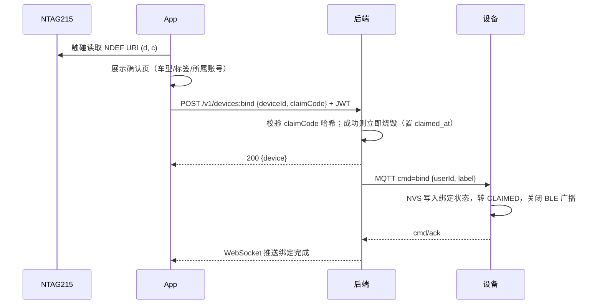
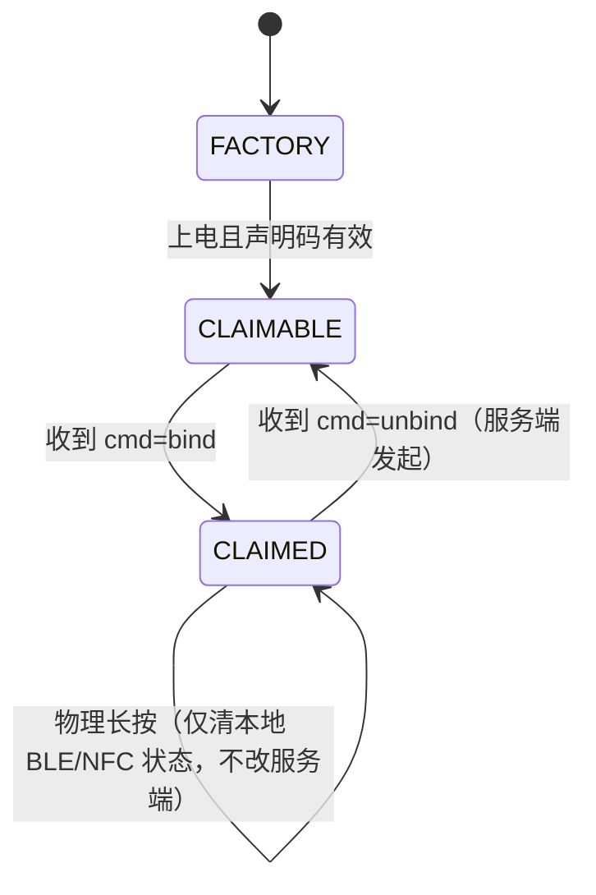

# 绑定与近场（App ↔ 设备）

本文件是**手机端与固件的契约**，与 [protocol.md](protocol.md)（设备↔云）配套。

## 1. 设计原则

1. **NFC 只提供"在场证明"，不提供"所有权"。** 普通 NTAG 标签可被任意读取甚至克隆，
   因此标签里的声明码必须由后端核验、且**一次性烧毁**（见 [ADR-0003](adr/0003-nfc-binding.md)）。
2. **BLE 连接不授予任何权限。** 它只做状态查看、近场提示和本地找车，不参与绑定与解绑。
3. **BLE 与 RSSI 不得用于布防/撤防判定。** 2.4 GHz 信号易受人体、车体、环境遮挡影响，
   边界抖动会造成大量误报；防盗判定一律在后端用 GNSS 轨迹 + 围栏 + 震动事件完成。
4. **解绑只能由车主账号在服务端发起。** 设备上的物理按键只清本地状态，绝不清服务端绑定。

> 为什么第 4 条重要：若长按能清服务端绑定，偷车者拿到车后一按键，车辆就从未授权列表消失，
> 防盗定位直接失效。

## 2. 出厂写入

每台设备在产线获得三项材料，其中后两项不可再生：

| 项 | 形式 | 存放位置 |
|---|---|---|
| `deviceId` | `BKL-<年份>-<6 位序列>`，如 `BKL-2026-000123` | 外壳丝印 + NVS + NFC 标签 |
| `claimCode` | 16 字符 Base32（80 bit 熵） | 明文只进 NFC 标签与产线工站；后端仅存带 pepper 的 HMAC-SHA256 哈希 |
| `deviceSecret` | 32 字节随机，base64 | NVS（MQTT 密码），后端存哈希 |

NFC 标签（NTAG215）写入 **NDEF URI 记录**，随后**永久上锁**：

```
https://<domain>/bind?d=BKL-2026-000123&c=7QK2M5XJ4TZP6RWN
```

用 URI 而不是自定义记录，是因为 iOS 锁屏触碰与 Android 都能直接唤起 App，
不必为两端各写一套 NDEF 解析。`c` 参数长度固定 16，便于校验。

## 3. 绑定流程



后端接口：

```
POST /v1/devices:bind   { "deviceId": "...", "claimCode": "..." }
  200 { device }                      绑定成功
  403 invalid_claim                   声明码错误（不区分"设备不存在"，防枚举）
  409 already_bound                   已被绑定；只回 error/message，不回车主任何信息
  429 rate_limited                    同账号 10 次/小时、同 IP 30 次/小时（M1）
DELETE /v1/devices/{deviceId}/binding 仅车主账号可调用
```

要点：

- 声明码校验用**恒定时间比较**哈希结果，避免时序侧信道。
- **判定顺序**：先校验声明码，再看是否已绑定（`backend/internal/device/service.go`）。
  顺序不能反——否则任何知道 `deviceId` 的人都能探出该车是否已注册。
- **声明码的生命周期**：设备处于已绑定状态时该码无效（重复触碰返回"已绑定"）；
  车主**解绑后恢复可用**。因为 NFC 标签上锁后无法改写，二手转让只能靠原标签重新绑定。
  推论：解绑是敏感操作——解绑后任何能碰到车的人都能绑定它。若车主只是想暂停监控，
  应使用"暂停告警"而不是解绑。
- 哈希在绑定后**保留不删**，`claimed_at` 才是"已使用"标记。
- 设备离线时绑定仍应成功——后端先落库，`bind` 指令进入待投递队列，设备上线后自动收到。
- App 在绑定页必须显示 `deviceId`，让用户能核对与车上丝印是否一致。

## 4. 设备状态机



- `FACTORY` / `CLAIMABLE`：BLE 可广播，`device-info` 可读。
- `CLAIMED`：默认关闭 BLE 广播；仅在 App 连接成功或收到 `set_config{ble_enabled:true}` 时开启。
- 物理长按 10 s：重启并清除本地 BLE 配对缓存 + 重发一次 `status`。**不触碰服务端绑定。**

## 5. BLE GATT 定义

设备为 Peripheral（NimBLE），App 为 Central（`flutter_blue_plus`）。

| 项 | UUID | 属性 | 载荷 |
|---|---|---|---|
| Service | `6f0b0001-1e5a-4f6b-9c3d-1a2b3c4d5e6f` | — | — |
| `device-info` | `6f0b0002-…` | read | 见 §5.1 |
| `status-notify` | `6f0b0003-…` | read, notify | 同 §5.1，状态变化时推送 |
| `local-cmd` | `6f0b0004-…` | write | 见 §5.2 |
| `local-ack` | `6f0b0005-…` | notify | 见 §5.2 |

广播名：`BKL-<deviceId 后 4 位>`；广播包里带 Service UUID 便于过滤。

### 5.1 device-info / status-notify

```json
{ "id": "BKL-2026-000123", "model": "BKL1", "fw": "0.1.0",
  "battery": { "mv": 3890, "pct": 76 }, "gpsFix": true, "online": true,
  "state": "CLAIMED", "ts": "2026-10-30T06:12:03Z" }
```

### 5.2 local-cmd / local-ack

```json
{ "op": "find", "id": "3f2a...", "params": { "dur_s": 10 } }
```

| `op` | 用途 | 是否需要网络 |
|---|---|---|
| `find` | 闪灯 + 蜂鸣，帮车主在车群中找车 | 否 |
| `locate` | 立即开 GNSS 并上报一次 | 是（离线则排队） |
| `read_battery` | 触发一次电量采样并回填 | 否 |
| `reboot` | 重启 | 否 |

ack：`{ "id": "3f2a...", "ok": true, "error": null }`，`error` 取值同 protocol.md §7.2。

### 5.3 分片

BLE 单次写入默认只有 20 字节，JSON 必然超长，必须分片：

- App 先请求 MTU 517（Android `requestMtu`；iOS 自动协商到 185/527 不等）。
- 分片格式：`[seq:1][flags:1][payload]`，`flags` 的 bit0 表示最后一帧，每帧 payload ≤ 180 字节。
- 设备侧按 `seq` 重组，10 s 未收齐则丢弃并回 `error: "internal"`。
- **不要**假设两个平台的 MTU 相同；Android 需主动协商，iOS 上 `mtu` 值仅供参考。

## 6. 近场判定（仅 UI）

只有一处使用 RSSI：App 显示"车在附近"。

- 进入阈值 `RSSI > -65 dBm`，退出阈值 `RSSI < -78 dBm`（滞回 13 dB，防抖）。
- 连续 3 个采样（约 2 s）才改变状态。
- 结论只用于 UI 文案与"找我的车"按钮的高亮，**不得**写入后端作为位置或状态事实。

## 7. 异常处理

| 现象 | 处理 |
|---|---|
| 触碰后 App 未安装 / 未登录 | 打开落地页，引导安装或登录后自动继续 |
| 该设备已被别人绑定 | 明确提示"该设备已被绑定"，提供客服入口；不回显车主信息 |
| 声明码错误 | 统一提示"标签无效或已使用"，不透露设备是否存在 |
| BLE 连接成功但 `state=CLAIMED` 且非车主 | 只允许 `find`，其余 `op` 返回 `not_supported` |
| 绑定后设备长时间未收到 `cmd=bind` | 后端在 App 侧显示"等待设备联网确认"，可重发 |
