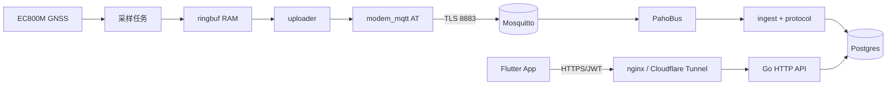

# M1a 端到端设计：真车轨迹到 App

- 状态：已批准（2026-11-20）
- 日期：2026-11-20
- 范围：一辆真实自行车、一个真实 GNSS 点、App 地图上的一条轨迹
- 关联：`docs/protocol.md`、`docs/pairing.md`、`docs/data-model.md`、`docs/deployment.md`、`docs/hardware.md`、`docs/roadmap.md`
- 建议分支：从最新 `origin/main` 新建 `feat/m1a-end-to-end`

## 1. 为什么做这个

项目已经有用户/JWT/Postgres/HTTP API 和 Flutter 登录、车辆列表、绑定/解绑，但**设备数据还进不了云端**：后端 MQTT 是 `LogBus` 桩，固件 `modem_at` / `modem_mqtt` / `modem_gnss` 也是桩。现在缺的不是更多页面，而是第一条真实链路：

```text
真车 GNSS → EC800M MQTT → 自建 Mosquitto(TLS) → Go ingest → Postgres → App 地图
```

M1a 的目标只有一个：**尽快在 App 上看到一辆真车的真实轨迹**。离线补传、低功耗、NFC、BLE、骑行记录、围栏、OTA 都不阻塞这条主线。

## 2. 目标、非目标与反目标

### 目标

- 设备身份来自 NVS，不再使用 `BKL-0000-000000` 占位值。
- 设备通过 **MQTT over TLS（8883）** 连接自建 Mosquitto，每设备独立凭据 + ACL。
- 后端接真实 MQTT 客户端，复用现有 `internal/protocol` 与 `ingest`，数据落 Postgres。
- App 能登录、绑定设备、看到最后位置与最近轨迹（地图折线）。
- 退出标准：真车室外开机 5 分钟内，App 地图出现至少一个点；重启后端后数据仍在。

### 非目标（M1b/M2 再做）

- LittleFS 落盘、掉电/断网后的离线补传（M1a 用 RAM ringbuf，允许重启丢缓存）。
- 深度睡眠、PSM/eDRX、睡眠前 `online:false`。
- NFC 读取/写入、BLE 状态服务、锁屏触碰。
- 骑行切分、骑行列表、历史回放、围栏、告警、OTA。
- iOS、多用户/共享车辆、生产级监控与告警。

### 反目标（即使能跑通也不接受）

- 匿名 MQTT、明文 MQTT、共用一套设备凭据。
- 把声明码、MQTT 密码、服务器私钥写进仓库或日志。
- 用模拟数据冒充实车验收。
- 为了“先跑通”绕过 JWT、TLS 或声明码校验。
- 在 App 里内嵌 Cloudflare Access 服务令牌。

## 3. 现状与约束

| 层 | 已有 | 缺口 |
|---|---|---|
| App | 登录/JWT、会话持久化、车辆列表、绑定/解绑；`api.bycicle-locating.top` 已能在 Access 外访问 | 地图仍占位；没有位置/轨迹查询；NFC/BLE 是桩 |
| 后端 | 用户/JWT/Postgres/HTTP、Docker 部署、协议解码、ingest、幂等落库；线上已切 prod + Postgres + JWT | MQTT 仍是 `LogBus`；没有位置/轨迹 API；`docs/deployment.md` 仍写 dev + 内存，已过期 |
| 固件 | IDF v5.5.6 构建、音频真机发声、ringbuf/uploader/proto 主机可测 | `modem_at/mqtt/gnss` 桩；NVS 设备身份/凭据未接；采样任务未接；seq 未持久化 |
| 基础设施 | 服务器 Debian 13 + Docker + nginx + cloudflared；`api.` 返回 200；Cloudflare Access 只覆盖主站 | `mqtt.` DNS 不存在；入站 TCP 8883 未验证；证书/ACL 未配 |

> **线上环境核实（2026-11-20）**：`docs/app-auth-acceptance.md` 记录 2026-11-13 已切 `APP_ENV=prod` + Postgres + JWT，并清空 dev seed；实测 `https://api.bycicle-locating.top/v1/users/me` 带 `X-Dev-User` 返回 401。`docs/deployment.md` 的“dev + 内存”描述已过期。M1a **不得回退到 dev**。

**硬约束**

- 设备在运营商 CGNAT 之后，只能主动出站；broker 必须公网可达。
- 服务器在中国大陆且域名未备案：部署文档记录阿里云会按 Host 拦截入站 HTTP（80/8080/32525 已试过，换非标端口无效）。**2026-11-20 已验证 TCP 8883 直连可用**：`mqtt.bycicle-locating.top` 解析到服务器公网 IP，TLS 握手成功，匿名 CONNECT 返回 `not authorized`。服务器 IP 只写在私有运维记录，不进仓库。
- Cloudflare Tunnel 只承载 HTTP/HTTPS；ESP32 不能跑 cloudflared，不能用 Tunnel 直接连 MQTT。
- EC800M 的 MQTT 是 AT 栈；`AT+QMTPUBEX` 是两段式，URC 会插在回显中间。
- 固件不能用 `%f`（`CONFIG_NEWLIB_NANO_FORMAT=y`），所有物理量用定点整数。
- 协议排序只信 `seq`，不信设备时钟；`(deviceId, seq)` 全局唯一。
- MQTT 载荷上限 4 KB，单批 ≤ 60 点。
- 现有 API 的公开入口 `https://api.bycicle-locating.top` 已经绕过 Access；主站 `https://bycicle-locating.top` 仍受 Access 保护。

## 4. 方案选择

| 方案 | 内容 | 取舍 | 结论 |
|---|---|---|---|
| **A. 自建 Mosquitto（选定）** | 现有服务器开 8883/TLS，Let's Encrypt 证书，Mosquitto 密码文件 + ACL | 与架构/文档一致、无第三方；需要 DNS、证书、防火墙、broker 运维 | **采用** |
| B. 托管 MQTT | EMQX Cloud/HiveMQ Cloud 免费层 | 最快，但多一个临时供应商与迁移 | 仅在 A 的入站端口被彻底封死时作为临时备选 |
| C. HTTPS 直传后端 | 复用现有 Cloudflare 入口，新增 HTTP ingest | 协议/架构分叉，要维护两套 ingest | 不采用 |

A 的 **Gate 0 已通过（2026-11-20）**：`mqtt.bycicle-locating.top` 解析到服务器公网 IP，TCP 8883 可达，TLS 握手成功；匿名 MQTT CONNECT 返回 `not authorized`（符合预期）。证书不是 Let's Encrypt，而是私有 CA（见 §6.1），因此后续不依赖 90 天续期。

若端点/端口后续变化导致不可达，按顺序尝试：换 443/TCP；公网中继 VPS 做 TCP 透传（TLS 仍在源站终止，或用服务器主动发起的反向隧道）；临时托管 broker（B）。这些仅作为风险备选。

## 5. 总体架构



- 设备上行主题：`v1/device/<id>/telemetry`、`/event`、`/status`。
- 后端订阅：`v1/device/+/+` 与 `v1/device/+/cmd/ack`（现有 `wireIngest` 已做主题白名单、载荷校验、主题/载荷设备 ID 一致性检查）。
- M1a 只做上行；下行 `cmd` 与 `cmd/ack` 保留接口，不实现业务。
- QoS 1；消息大小限制 4 KB。

## 6. 详细设计

### 6.1 基础设施（Gate 0 之后）

- **DNS（已存在）**：`mqtt.bycicle-locating.top` 是直连 A 记录，指向服务器公网 IP；不是 Cloudflare 代理。2026-11-20 验证解析正常。
- **端口（已放行）**：`8883/tcp` 已从外部网络连通；匿名 CONNECT 被拒。若后续网络策略变化，按 §4 备选处理。
- **证书（已存在，私有 CA）**：Broker 当前使用私有 CA `Bicycle Locating MQTT CA` 签发的证书，CN=`mqtt.bycicle-locating.top`，SAN 匹配，有效期 2026-11-20 至 2031-11-19。证书链不是公共 CA，因此：
  - 后端必须把 CA 证书挂载进容器并用 `MQTT_CA_FILE` 指定，不能依赖系统根。
  - EC800M 必须导入同一份 CA 证书（`AT+QFUPL` 上传到 UFS + `AT+QSSLCFG="cacert"`）；这是 Gate 1 的关键验证项。
  - CA 私钥只在服务器，权限 0600，不进仓库；2031 年到期前轮换，M1b 记录轮换步骤。
  - 不再需要 Let's Encrypt/DNS-01；Cloudflare API token 只用于 DNS 变更。
- **Mosquitto**：新增生产 listener：
  - `listener 8883`
  - `allow_anonymous false`
  - `password_file /mosquitto/config/passwd`
  - `acl_file /mosquitto/config/acl`
  - `cafile` / `certfile` / `keyfile`
  - `tls_version tlsv1.2`
  - `message_size_limit 4096`
  - `persistence true`
- **账号/ACL**：
  - 设备用户名 = `deviceId`；密码随机生成，写入设备 NVS 与服务器 `passwd`，不进仓库。
  - ACL 用 Mosquitto `pattern`：
    - 设备：`pattern write v1/device/%u/#`、`pattern read v1/device/%u/cmd`
    - 后端：`user backend`，读 `v1/device/+/+`，写 `v1/device/+/cmd`
  - 禁止匿名；错误密码/越权主题必须被拒绝。
- **Compose**：新增 `broker-tls` 服务（或扩展现有 `broker`），放在 `deps` profile；只发布 `8883:8883`；证书/密码/ACL 只读挂载；保留现有 1883 本地开发 broker，不破坏 e2e 脚本。
- **后端到 broker**：容器网络别名 `mqtt.bycicle-locating.top` 指向 broker，后端用 `mqtts://mqtt.bycicle-locating.top:8883` 连接；TLS 证书 SAN 匹配，流量不出 Docker 网络。
- **后端环境**：
  - `MQTT_URL=mqtts://mqtt.bycicle-locating.top:8883`
  - `MQTT_USER=backend`
  - `MQTT_PASSWORD=<server .env>`
  - `MQTT_CA_FILE=`（Let's Encrypt 用系统根；如自签则填 CA 路径）
- **数据库/环境**：线上已经是 `APP_ENV=prod` + Postgres + JWT（2026-11-13 切换；2026-11-20 实测 `X-Dev-User` 返回 401）。M1a **不降级到 dev**，直接复用现有 prod 实例；`docs/deployment.md` 里 dev + 内存的描述需要修正。
  - 需要一个 prod 可用的设备 provisioning 路径（`DEV_SEED_CLAIM` 只在 dev 执行，已清空）：新增 `backend/cmd/device-admin`（或等价 CLI），生成 16 位 Base32 声明码、用 `CLAIM_PEPPER` 计算 HMAC、写入 `devices` 行，并把声明码只打印一次；不得写日志或仓库。
  - 为 M1a 建一个专用验证设备（例如 `BKL-2026-990001`）和测试账号，避免污染 `BKL-2026-000001` 的产线编号；验收后解绑/保留审计。设备 ID 与声明码由人类确认后再建。
  - 变更前备份 `pg-data`；DB 卷不得删除。

### 6.2 后端

- **MQTT 客户端**：新增 `github.com/eclipse/paho.mqtt.golang`，实现 `mqtt.PahoBus`：
  - TLS（系统根或 `MQTT_CA_FILE`）、用户名/密码、`CleanSession=false`、自动重连、重连后重新订阅。
  - `Subscribe` 的 handler 必须串行（现有 `Bus` 契约）；paho 回调用互斥/队列串行化。
  - `Publish` 遵守 ctx 超时；错误分类记录。
  - `cmd/server` 的 `openBus`：配置了 `MQTT_URL` 用 Paho；纯内存 dev 无 broker 时回退 `LogBus` 并 WARN；`APP_ENV=prod` 必须配置。
- **存储**：`Store` 增加两个查询，Memory 与 Postgres 同步实现：
  - `LatestTelemetry(ctx, deviceID) (TelemetryPoint, error)`：按 `seq DESC LIMIT 1`。
  - `TelemetrySince(ctx, deviceID, since, limit) ([]TelemetryPoint, error)`：先按 `seq DESC` 取窗口内最新 `limit` 条，再反转为 `seq ASC` 返回；否则 24h + limit 500 会返回最旧的一段，地图会停在过去。
  - 只返回设备数据，不暴露车主/声明码。
- **HTTP API**（仅车主）：
  - `GET /v1/devices/{deviceID}/location` → `{deviceId, seq, ts, lat, lon, speedMps, courseDeg, altM?, hdop?, fix}`。
  - `GET /v1/devices/{deviceID}/track?since=<RFC3339>&limit=<1..500>` → `{points:[...]}`。
  - `since` 过滤 `ts`（M1a 只写 GNSS 有效点）；返回窗口内**最新** `limit` 条，按 `seq` 升序；缺省 24h/500，`limit` 夹紧。
  - 设备不存在与无权访问统一 403，避免枚举。
  - 更新 `docs/http-api.md`；现有 `handleGetDevice` 的 403/404 枚举问题在 M1b 统一。
- **Ingest**：复用现有 `wireIngest`/`ingest`；确保 `status` 更新 `last_seen_at`；重复 telemetry 幂等；事件重复的指标问题顺手修（`InsertEvent` 返回是否插入）。
- **测试**：
  - 单元：store 查询、API handler、排序/limit 边界、非车主 403。
  - 集成：Docker Mosquitto + `mqtts`，用 `mosquitto_pub`/Go 测试客户端发协议 JSON，验证 ingest 落库。
  - 安全：匿名连接、错误密码、跨设备主题均被拒绝。

### 6.3 固件

- **设备配置（NVS）**：
  - `device_id`（已有）、`mqtt_user`、`mqtt_pass`、`mqtt_host`、`mqtt_port`、`seq`。
  - 新增 `scripts/provision-device.py`：生成 NVS CSV/镜像（`nvs_partition_gen.py`），随机生成 MQTT 密码，输出写入命令与服务器端 `mosquitto_passwd` 命令；密码不写仓库。
  - NVS 分区 0x9000/0x5000（以 `partitions.csv` 为准）；用 `esptool write_flash 0x9000 nvs.bin` 写入。
  - 设备 ID 使用 `BKL-2026-000001`，与后端 seed 一致。声明码由 `DEV_SEED_CLAIM` 提供，设备端不需要。
- **`modem_at`**：
  - UART1、GPIO17(TX)/16(RX)、115200 8N1；单写线程 + 单读线程。
  - 按行解析，处理 echo、`OK`/`ERROR`/`+CME ERROR`、URC 插行；每条命令带超时与一次重试。
  - 把“行解析/URC 分派”抽成纯函数，主机单测覆盖录制到的真实日志片段。
- **时间门（TLS 前）**：启动后先确认模组时钟（`AT+CCLK?`）或网络时间（`AT+QLTS`）；没有有效时间时由 GNSS UTC 设置 `AT+CCLK`。TLS 证书有效期校验若依赖系统时间，时间未就绪会导致握手失败；没有有效时间前不建立 MQTT 连接。具体依赖在 Gate 1 的 AT spike 里确认。
- **`modem_mqtt`**：
  - 连接序列：`AT+QMTCFG="version",0,4`；TLS 时 `AT+QMTCFG="ssl",0,1,0` + `AT+QSSLCFG`；`AT+QMTOPEN`；`AT+QMTCONN`。
  - 发布：`AT+QMTPUBEX=0,<msgId>,1,0,"<topic>",<len>` → 等 `>` → 裸载荷 → 等 `OK`/`+QMTPUB: 0,<msgId>,0`。
  - M1a 只实现 publish + 连接状态；subscribe/cmd 留接口。
  - **TLS 预检**：先用 AT 命令验证 EC800M 对 Let's Encrypt 根证书的信任。若模组不信任 ISRG Root X1，用 `AT+QFUPL` 上传根证书到 UFS 并 `AT+QSSLCFG="cacert"`；若仍失败，记录错误并评估 ESP32 侧 TLS + `AT+QIOPEN` 透传作为备选（不在 M1a 默认范围）。
- **`modem_gnss`**：
  - `AT+QGPS=1`；`AT+QGPSLOC?` 解析经纬度、UTC、速度（**km/h → m/s**）、航向、海拔、HDOP、fix。
  - 解析器必须以**真实 `AT+QGPSLOC?` 响应**为准：先在 Gate 1 用模组/外接 USB-TTL 抓一份室外有效定位和一份室内错误样本，再写 fixture；不按常见 Quectel 顺序猜字段。
  - 解析器抽成纯函数，主机单测覆盖室内 `CME ERROR: 516`、无定位、真实有效样本。
- **采样/上报任务**：
  - 每 10 s 读 GNSS；有效则写入 RAM ringbuf（容量 64 点）并持久化 `seq` 到 NVS。
  - 每 60 s 或攒到 5 点，调用 `bkl_uploader_step`，transport 用 `bkl_mqtt_publish`；失败退避。
  - 连接成功后发布一次 `status{online:true}`；异常断开不强制补发（M1a），M1b 加 `online:false`。
  - 启动时从 NVS 恢复 `seq`，避免重启后重复 seq 被后端去重。
- **主流程**：加载 NVS → 初始化 AT → 时间门（网络时间/GNSS UTC）→ 连接 MQTT（带重试）→ 打开 GNSS → 启动采样/上报任务；失败只 WARN 不阻塞其他外设。
- **构建/测试**：`idf.py build` 必须过；新增解析器主机单测；`CONFIG_BKL_AUDIO_SELFTEST_ON_BOOT` 保持默认关。

### 6.4 App

- **依赖**：`flutter_map` + `latlong2`（OSM 瓦片，无 API key）；不引入 Google Maps。
- **API**：`ApiClient` 增加 `fetchLocation(deviceId)`、`fetchTrack(deviceId, since, limit)`；解析 DTO；沿用 `ApiException`/401 登出逻辑。
- **Provider**：基于 `selectedDeviceProvider` 的 `locationProvider` 与 `trackProvider`，地图页每 10 s 刷新；页面 dispose 时取消定时器。
- **地图页**：把现有“暂无位置”卡片替换为：
  - `FlutterMap`（OSM 瓦片、initialCenter 为最后点或上海默认、zoom 15）；
  - 最后位置 Marker + 最近轨迹 Polyline；
  - 顶部/底部浮层显示设备名、最后更新时间、速度（km/h，展示层换算）、fix/HDOP；
  - 无位置时显示“暂无位置”；错误时显示重试。
- **验收 UI**：登录 → 车辆页绑定/选择 `BKL-2026-000001` → 地图出现点与折线；下拉/自动刷新。
- **测试**：map 页空/加载/数据三态 widget 测试；API 解析单测；不引入真实网络测试。

### 6.5 文档与契约

- `docs/roadmap.md`：把实际进度从 M0 修正到 M1，拆出 M1a/M1b 勾选项。
- `docs/protocol.md`：补充 broker TLS/ACL、设备凭据、seq 持久化；不改字段。
- `docs/http-api.md`：新增 location/track 接口与错误语义。
- `docs/deployment.md`：新增 MQTT DNS/证书/8883/Gate 0/回滚。
- `docs/hardware.md`：补 flash 实测 16 MB（当前按 8 MB 使用）与设备 provisioning。
- `firmware/README.md`、`AGENTS.md`：更新模块状态与验证状态。
- 所有跨端字段改动仍按 AGENTS §3.1：先文档、同一 PR、贴协议 diff。

## 7. 实施顺序（建议）

| 阶段 | 内容 | 退出条件 |
|---|---|---|
| 0 | Gate 0：8883 入站、DNS、证书；Mosquitto TLS + ACL；`mosquitto_pub/sub` 手工验证 | 外网 TLS 连接成功，匿名/错密码被拒 |
| 0.5 | 基线：合并 PR #10（或 M1a 分支基于 `audio-fix`），保证音频/IDF 构建可用 | `idf.py build` 通过，音频回归不破坏 |
| 1 | 后端 PahoBus + 存储查询 + location/track API + `device-admin` provisioning + 测试；用 `mosquitto_pub` 模拟设备发协议 JSON | 后端落库，API 返回点；重启后仍在 |
| 2 | 固件 AT/TLS/GNSS spike（真实 `AT+QGPSLOC?` 样本、时间门）→ NVS provisioning + AT 引擎 + MQTT publish + 采样/上传 | 设备连上 broker，后端收到真实点 |
| 3 | App 地图 + API + 轮询 | App 显示设备最后位置与折线 |
| 4 | 室外端到端验收、日志/错误处理、文档收尾 | §2 退出标准全部满足 |

固件 AT/TLS 是最大不确定项，Gate 0 之后先做“AT+TLS+QMTOPEN”最小 spike，再写完整模块。

## 8. 测试与验收清单

- [ ] 外网 `nc -vz mqtt.bycicle-locating.top 8883` 成功；匿名/错误密码被拒。
- [ ] ACL：设备 A 不能读写设备 B 的主题；后端只能读上行/写 cmd。
- [ ] 设备 NVS 中 deviceId/凭据正确；重启后 seq 不回退。
- [ ] `mosquitto_pub` 模拟 telemetry → 后端 ingest → Postgres 有行。
- [ ] 后端重启后数据仍在；重复 seq 不重复落库。
- [ ] App 登录、绑定、地图显示最后点与折线；10 s 内刷新。
- [ ] 真车室外 5 分钟内出现至少一个真实点。
- [ ] 固件 `idf.py build`、主机单测；后端 `go test ./...`；App `flutter analyze/test` 全绿。
- [ ] 仓库无密码/私钥/声明码；日志无完整坐标与凭据。

## 9. 部署与回滚

- 保留现有 dev 栈；新增 broker TLS 与 Postgres/JWT 配置，逐项切换。
- 迁移前 `pg_dump` 备份；证书私钥只在服务器。
- 回滚：后端 `MQTT_URL` 留空回退 LogBus；broker 回退本地 dev；DB 回退内存只用于临时验证（会丢数据）。
- 证书续期失败时设备会在证书过期后无法连接；M1b 加监控/续期告警。

## 10. 风险与缓解

| 风险 | 影响 | 缓解 |
|---|---|---|
| 入站 8883 被云厂商封 | A 无法直连 | Gate 0 先验证；备选 443/TCP、中继 VPS、临时托管 broker |
| EC800M 无法导入私有 CA | TLS 握手失败 | Gate 1 先做 AT TLS + `AT+QFUPL`/`AT+QSSLCFG` 预检；若模组不支持自定义 CA，改用公共 CA 证书或 ESP32 TLS + QIOPEN |
| 私有 CA 到期/私钥泄露 | 证书过期或中间人风险 | CA 私钥 0600 仅服务器；2031 前轮换；M1b 记录轮换步骤 |
| AT URC 插行/echo 解析 | 连接不稳定 | 行解析器 + 真实日志 fixtures + 主机单测 |
| GNSS 室内无定位 | 无法验收 | 室外/窗边测试；允许首次定位 30–90 s |
| 线上仍是 dev+内存 | 重启丢数据 | M1a 切 Postgres+JWT；备份；M1b 切 prod |
| api. 的 Access 策略变化 | App 302/不可用 | 已验证 200；变更后检查 Access 应用范围 |
| flash 实际 16 MB / 配置 8 MB | 暂时不影响 | 文档记录；后续可扩分区 |
| 地图瓦片/OSM 使用政策 | 长期不可用 | M1a 仅验证；生产换瓦片源/自建 |

## 11. 已拍板的假设（用户可随时推翻）

1. **MQTT 直连（已验证）**：2026-11-20 实测 `mqtt.bycicle-locating.top:8883` 可连通，TLS 握手成功，匿名 CONNECT 被拒；证书为私有 CA，后续按私有 CA 方案。
2. **验证设备**：在现有 prod Postgres 建专用 `BKL-2026-990001` + 测试账号，经 `device-admin` 创建；验收后解绑。若不想在生产库留测试数据，改用隔离 validation 栈。
3. **App 地图**：M1a 用 OSM + `flutter_map` + WGS-84，明确作为 AGENTS 展示层 GCJ-02 约定的临时例外；若国内瓦片不可达，退化为经纬度画布/列表。生产地图与 GCJ-02 在 M2 前补。
4. **AT/GNSS 样本**：必须先抓真实 `AT+QGPSLOC?` 响应；优先用外接 USB-TTL，室外一份 + 室内一份。若不方便，先做一个临时 AT 控制台固件 spike（只用于抓样本，不进入产品路径）。
5. **分支基线**：优先等 PR #10 合并后从最新 `origin/main` 开 `feat/m1a-end-to-end`；若 #10 暂时不合并，则基于 `audio-fix` 开发，最后 rebase。

## 12. 决策记录

- 采用 A：自建 Mosquitto + 直连 8883/TLS（用户已确认有服务器）。
- 线上已是 `APP_ENV=prod` + Postgres + JWT；M1a 复用 prod，不回退 dev。
- M1a 用 RAM ringbuf，LittleFS/离线补传放 M1b。
- 不复用产线编号 `BKL-2026-000001`；用专用验证设备 `BKL-2026-990001`，经 `device-admin` CLI 创建；默认放现有 prod Postgres。
- MQTT 凭据写 NVS，不进仓库；证书/密码只在服务器。
- M1a 用 `flutter_map` + OSM + WGS-84 的临时例外；生产地图与 GCJ-02 在 M2 前补，不用 Google Maps。
- 已验证 8883 直连可用（2026-11-20）；证书使用现有私有 CA `Bicycle Locating MQTT CA`，后端/模组导入 CA，不走 Let's Encrypt。
- 真车 AT/GNSS 样本优先外接 USB-TTL 抓取；必要时先做临时 AT 控制台 spike。
- 优先等 PR #10 合并后从最新 `origin/main` 开 M1a 分支。
- 后端用 paho；新增依赖的理由是官方文档已规划 paho，且 MQTT 是产品主链路。
- Track 查询返回窗口内最新 N 条（`seq DESC` 取、`seq ASC` 返回）。
- TLS 前增加时间门；GNSS 解析器以真实 AT 响应为准。
